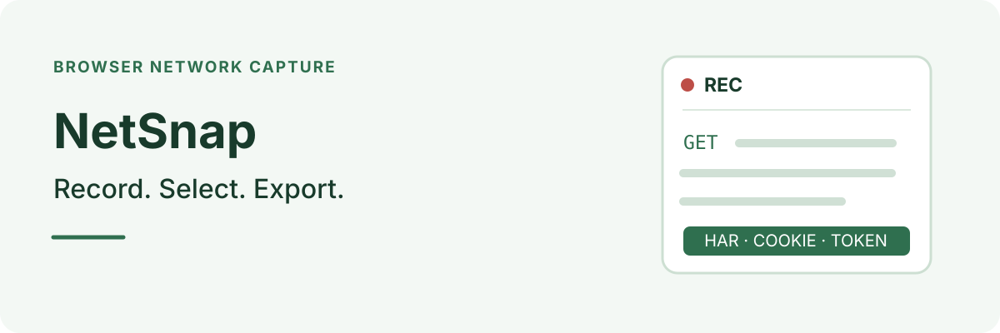

**English | [简体中文](README.zh-CN.md)**

  

NetSnap records browser network traffic and exports exactly what you need: a HAR file, cookies, tokens or a Markdown request summary. No DevTools, no right-click, no Save As.

## Features

- **Record in one click**: start recording, perform the action you want to capture, then stop. Requests, responses and bodies are captured through the Chrome DevTools Protocol.
- **Choose the exports**: tick HAR, Cookie and Token independently, and download only what you select.
- **Select requests**: export every captured request or only the ones you check, filtering out unrelated assets.
- **Collect cookies**: read cookies from request `Cookie` headers and response `Set-Cookie` headers, then deduplicate them.
- **Collect tokens**: extract credentials from `Authorization` headers, covering sites whose login state is not stored in cookies.
- **Download a summary**: save a Markdown table of methods, URLs and status codes for a quick review.
- **Keep HAR standard**: exports follow HAR 1.2 and can be imported into tools such as Postman or Charles for replay.
- **Stay local**: processing happens in the browser, with no telemetry, build step or npm dependencies.

## Install

1. Download or clone this repository.
2. Open `chrome://extensions` in Chrome or Edge.
3. Turn on **Developer mode**.
4. Choose **Load unpacked** and select the `NetSnap` directory.
5. Pin NetSnap to the toolbar.

## Record and export

1. Open and sign in to the site you want to record.
2. Open NetSnap and start recording. Keep the browser's debugging notice open.
3. Perform the action you want to capture.
4. Stop recording.
5. Tick HAR, Cookie and/or Token, choose all or checked requests, and download.

The yellow “This tab is being debugged” banner is a Chrome security notice and cannot be hidden. Closing it stops the recording. Recording uses one debugger per tab, so do not open DevTools on the same tab at the same time.

## What you get

| Export | Contents |
|---|---|
| HAR | A HAR 1.2 file with captured requests, responses and bodies |
| Cookie | Cookies from request and response headers, deduplicated |
| Token | Values extracted from `Authorization` headers |
| Summary | A Markdown table of method, URL and status code |

## How it works

NetSnap attaches `chrome.debugger` to the current tab, listens for network events through the Chrome DevTools Protocol, and builds the selected exports from the captured data.

| Permission | Purpose |
|---|---|
| `debugger` | Capture requests, responses and bodies through CDP |
| `downloads` | Save HAR, cookie, token and summary files |
| `activeTab` | Attach the recorder to the tab you are viewing |
| `storage` | Keep recording results when the popup closes and reopens |

NetSnap does not request the `cookies` permission. It reads cookie values from network headers instead, which keeps the permission set smaller.

## Limits

- Chrome, Edge, Brave and other Chromium browsers are supported. Firefox is not supported because its debugger/CDP behavior differs.
- Protected pages such as `chrome://` pages cannot be recorded; switch to a normal web page first.
- Very large response bodies may be missing from the HAR because CDP refuses to return them. Headers and status codes are still included.
- Exports are downloaded as separate files, not packaged into a ZIP, to keep the extension dependency-free.
- HAR files contain live credentials in plain text. Treat them like passwords and do not share them publicly.

## Development

Project layout

There is no build step and no npm dependency. Load the directory as an unpacked extension after each change.

| File | Purpose |
|---|---|
| `manifest.json` | Manifest V3 definition and permissions |
| `background.js` | Service worker: CDP capture, HAR export and credential extraction |
| `har-builder.js` | Converts CDP events into HAR 1.2 |
| `popup.html`, `popup.css`, `popup.js` | Popup UI and interactions |
| `icons/` | Extension icons |
| `docs/使用手册.md` | Permissions, limits, FAQ and troubleshooting |

See the [user manual](docs/使用手册.md) for permission details, known limits and troubleshooting.

## License

[MIT](LICENSE) · [Follow YanGN on Xiaohongshu](https://www.xiaohongshu.com/user/profile/66a7e7ae000000001d023641)
