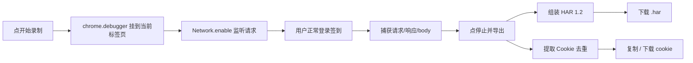

# HarSnap

一键录制浏览器网络请求 → 导出 HAR 文件 + 提取 Cookie。不开 DevTools、不点右键、不手动另存，点两下按钮完成。

## 功能特性

- **一键录制**：点「开始录制」→ 正常登录签到 → 点「停止」，网络请求自动捕获。
- **不开 DevTools**：走 Chrome DevTools Protocol（chrome.debugger），无需手动 F12、无需勾 Preserve log。
- **导出 HAR 1.2**：标准格式，可直接导入 DailyCheckin / Postman / Charles 等工具回放。
- **单独提取 Cookie**：从请求 Cookie 头 + 响应 Set-Cookie 自动提取、去重，列表可一键复制。
- **纯本地**：数据不出本机，无遥测、无后端、无外部请求。
- **零依赖**：原生 JavaScript + MV3，无构建步骤、无 npm 依赖。

## 快速开始

### 手动加载（开发者模式）

1. 下载本仓库（Code → Download ZIP 或 `git clone`）。
2. 打开 Chrome / Edge 的 `chrome://extensions`。
3. 右上角打开「开发者模式」。
4. 点「加载已解压的扩展程序」，选择 `HarSnap` 目录。
5. 工具栏出现 HarSnap 图标，固定它，完成。

### 使用

1. 打开要录制签到的网站，正常登录。
2. 点 HarSnap 图标 → 「● 开始录制」（浏览器顶部会出现「正在调试」提示条，**不要关**）。
3. 回到网页，点一次签到按钮。
4. 再点 HarSnap 图标 → 「■ 停止并导出」。
5. 查看提取的 Cookie（可单个 / 全部复制），点「下载 HAR」。

## 目录结构

```
HarSnap/
├── manifest.json        # MV3 清单
├── background.js        # service worker：CDP 捕获 + HAR 导出 + Cookie 提取
├── har-builder.js       # CDP 事件 → HAR 1.2 组装
├── popup.html           # 弹出面板
├── popup.css            # 面板样式
├── popup.js             # 面板交互
└── icons/               # 插件图标
```

## 工作原理



## 权限说明

| 权限 | 用途 |
|---|---|
| `debugger` | 通过 CDP 捕获完整网络请求（含响应体） |
| `downloads` | 下载 HAR / Cookie 文件 |
| `activeTab` / `tabs` | 定位当前要录制的标签页 |
| `storage` | 缓存录制结果，popup 与后台共享 |

## 已知边界

- **「正在调试」黄色提示条**是 Chrome 的安全机制，用 `chrome.debugger` 必然出现，无法隐藏。录制时请勿关闭它，否则录制中断。
- **一个标签页同时只能有一个调试器**：录制时不要同时开着该标签页的 DevTools。
- **超大响应体**（几百 MB）可能被 CDP 拒绝返回，此时该请求只有 headers/status，无 body。
- 目前仅支持 Chromium 系浏览器（Chrome / Edge / Brave 等），Firefox 需另做（WebExtensions 差异）。

## License

MIT —— 详见 [LICENSE](LICENSE)。
