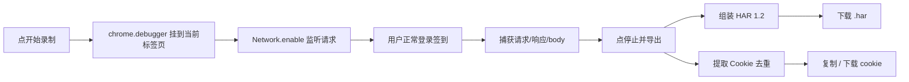

# HarSnap

一键录制浏览器网络请求 → 导出 HAR 文件 + 提取 Cookie / Token。不开 DevTools、不点右键、不手动另存，点两下按钮完成。

🔗 **源码**：https://github.com/ygnstudio/HarSnap
⬇️ **Chrome Web Store**：（待上架）

## 功能特性

- **一键录制**：点「开始录制」→ 正常签到 → 点「停止」，网络请求自动捕获，无需开 DevTools。
- **多选导出**：`HAR` / `Cookie` / `Token` 三项独立勾选，勾啥导啥。
- **单请求导出**：请求列表可勾选，「仅勾选」模式只导出勾中请求，过滤无关静态资源。
- **提取 Cookie 与 Token**：Cookie 从请求头 + Set-Cookie 去重；Token 从 `Authorization` 头提取，两种凭证都覆盖。
- **请求清单摘要**：一键下载 Markdown 表格（方法 + URL + 状态码）。
- **导出 HAR 1.2**：标准格式，可直接导入 DailyCheckin / Postman / Charles 等工具回放。
- **纯本地零依赖**：数据不出本机，无遥测、无构建步骤、无 npm 依赖。

## 快速开始

### 手动加载（开发者模式）

1. 下载本仓库（Code → Download ZIP 或 `git clone`）。
2. 打开 Chrome / Edge 的 `chrome://extensions`。
3. 右上角打开「开发者模式」。
4. 点「加载已解压的扩展程序」，选择 `HarSnap` 目录。
5. 工具栏出现 HarSnap 图标，固定它，完成。

### 使用

1. 打开要录制签到的网站，正常登录。
2. 点 HarSnap 图标 → 「● 开始录制」（浏览器顶部会出现「正在调试」提示条，**不要关**）。
3. 回到网页，点一次签到按钮。
4. 再点 HarSnap 图标 → 「■ 停止」。
5. 勾选要导出的内容（HAR / Cookie / Token）、选请求范围（全部 / 仅勾选），点「⬇ 下载所选」。

> Token 是从请求的 `Authorization: Bearer xxx` 这类头里提取的——很多站点登录态不在 Cookie 里，而在 token 里。

## 目录结构

```
HarSnap/
├── manifest.json        # MV3 清单
├── background.js        # service worker：CDP 捕获 + HAR 导出 + Cookie 提取
├── har-builder.js       # CDP 事件 → HAR 1.2 组装
├── popup.html           # 弹出面板
├── popup.css            # 面板样式
├── popup.js             # 面板交互
└── icons/               # 插件图标
```

## 工作原理



## 详细文档

- [使用手册](docs/使用手册.md) —— 权限逐项说明、已知边界、FAQ、故障排查

## License

MIT —— 详见 [LICENSE](LICENSE)。
