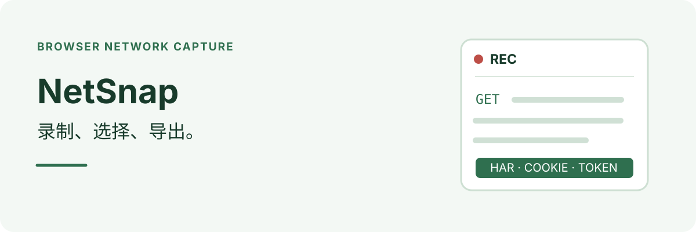

**[English](README.md) | 简体中文**

  

NetSnap 录制浏览器网络请求，并按需导出 HAR 文件、Cookie、Token 或 Markdown 请求摘要。不用打开开发者工具，不用右键，也不用另存为。

## 功能

- **一键录制**：开始录制、执行要捕获的操作、停止录制，请求、响应和响应体通过 Chrome DevTools Protocol 捕获。
- **按需导出**：HAR、Cookie、Token 三项独立勾选，只下载选中的内容。
- **选择请求**：导出全部请求，或只导出勾选的请求，过滤无关静态资源。
- **提取 Cookie**：从请求的 `Cookie` 头和响应的 `Set-Cookie` 头读取 Cookie，并去重。
- **提取 Token**：从 `Authorization` 头提取凭证，覆盖登录态不存放在 Cookie 里的网站。
- **下载摘要**：保存包含方法、URL 和状态码的 Markdown 表格，方便快速核对。
- **标准 HAR**：导出遵循 HAR 1.2，可导入 Postman、Charles 等工具回放。
- **纯本地处理**：处理在浏览器内完成，无遥测、无构建步骤、无 npm 依赖。

## 安装

1. 下载或克隆本仓库。
2. 在 Chrome 或 Edge 打开 `chrome://extensions`。
3. 打开「开发者模式」。
4. 选择「加载已解压的扩展程序」，选中 `NetSnap` 目录。
5. 将 NetSnap 固定到工具栏。

## 录制和导出

1. 打开并登录要录制的网站。
2. 打开 NetSnap 并开始录制，保留浏览器显示的调试提示。
3. 执行要捕获的操作。
4. 停止录制。
5. 勾选 HAR、Cookie 和/或 Token，选择全部或勾选的请求，然后下载。

浏览器顶部的「此标签页正在被调试」黄色提示条是 Chrome 的安全机制，无法隐藏。关闭提示条会停止录制。录制时每个标签页只允许一个调试器，因此不要同时在该标签页打开开发者工具。

## 导出内容

| 导出 | 内容 |
|---|---|
| HAR | 包含请求、响应和响应体的 HAR 1.2 文件 |
| Cookie | 从请求头和响应头提取并去重的 Cookie |
| Token | 从 `Authorization` 头提取的值 |
| 摘要 | 包含方法、URL 和状态码的 Markdown 表格 |

## 工作方式

NetSnap 通过 `chrome.debugger` 连接当前标签页，使用 Chrome DevTools Protocol 监听网络事件，再用捕获到的数据生成所选导出。

| 权限 | 用途 |
|---|---|
| `debugger` | 通过 CDP 捕获请求、响应和响应体 |
| `downloads` | 保存 HAR、Cookie、Token 和摘要文件 |
| `activeTab` | 把录制器连接到当前正在查看的标签页 |
| `storage` | 关闭再打开弹出面板时保留录制结果 |

NetSnap 不申请 `cookies` 权限，而是从网络请求头读取 Cookie，从而保持较小的权限范围。

## 限制

- 支持 Chrome、Edge、Brave 等 Chromium 浏览器。Firefox 的调试器/CDP 行为不同，暂不支持。
- `chrome://` 等受保护页面无法录制，请先切换到普通网页。
- 超大响应体可能不会写入 HAR，因为 CDP 会拒绝返回；请求头和状态码仍会保留。
- 导出会保存为多个独立文件，不打包成 ZIP，以保持扩展零依赖。
- HAR 文件包含明文登录凭证。请像对待密码一样保管，不要公开分享。

## 开发

项目结构

无需构建步骤和 npm 依赖。每次修改后，以「加载已解压的扩展程序」方式重新加载目录即可。

| 文件 | 用途 |
|---|---|
| `manifest.json` | Manifest V3 定义与权限 |
| `background.js` | Service Worker：CDP 捕获、HAR 导出与凭证提取 |
| `har-builder.js` | 把 CDP 事件转换为 HAR 1.2 |
| `popup.html`、`popup.css`、`popup.js` | 弹出面板的界面与交互 |
| `icons/` | 扩展图标 |
| `docs/使用手册.md` | 权限、限制、FAQ 与故障排查 |

权限细节、已知边界和故障排查见[使用手册](docs/使用手册.md)。

## 许可

[MIT](LICENSE) · [关注 YanGN 的小红书](https://www.xiaohongshu.com/user/profile/66a7e7ae000000001d023641)
